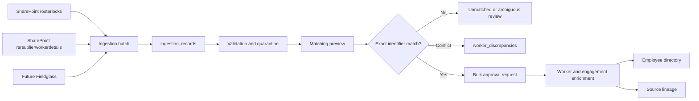

# Canonical Worker and Employee Architecture

## Purpose

The application treats `Worker` as the stable internal identity and `Employee` as the user-facing view of that identity. Source files are observations, not master records.

## Canonical Entities

### Worker

`workers.worker_id` is immutable and source-independent. Names, canonical email, lifecycle status, record version, and timestamps describe the person profile.

### Worker Identifier

`worker_identifiers` stores identifiers from each source, including Vendor Employee ID, RSR Worker ID, Buyer Reference, Fieldglass ID, NUID, and Salesforce ID. Identifier values are normalized for matching but the original value is retained.

### Worker Engagement

`worker_engagements` stores vendor, program, project, LOB, role, dates, licensing, work order, statement of work, and primary contact. A rehire creates another engagement while preserving the Worker ID.

`source_system` identifies the technical adapter and is not the business vendor. For the Fieldglass RSR export, `source_system` is `RSR_SUPPLIER_WORKER_DETAILS`, while `vendor_name` is derived from an explicit vendor field when available or from the first token of `statement_of_work` (for example, `TTEC` from `TTEC Contact Center Agent Services SOW 11109`). The complete SOW remains stored independently for traceability.

### Source Lineage

`worker_source_lineage` records source system, file, checksum, batch, row, field, raw value, normalized value, and observation time. This allows the Employee view to show where every field came from.

### Discrepancy

`worker_discrepancies` keeps the current and incoming values when sources disagree. No source silently overwrites an existing canonical value.

## RSR Matching Strategy

1. `Supplier Reference` matches `VENDOR_EMPLOYEE_ID` from the Roster Lock domain.
2. `Worker ID` matches an existing `RSR_WORKER_ID` when present.
3. `Buyer Reference` is a secondary exact identifier.
4. Multiple canonical matches become `AMBIGUOUS`.
5. No match becomes `UNMATCHED`; it remains staged until the bulk approval request. Once approved, it creates a new historical Worker and engagement rather than being silently discarded.
6. A single match with conflicting non-empty profile values becomes `CONFLICT` and is excluded from automatic application.

## Runtime States

`NOT_EVALUATED -> MATCHED | UNMATCHED | AMBIGUOUS | CONFLICT -> APPLIED`.

The watcher only stages and evaluates. A reviewer-approved bulk request is required before RSR enrichment or approved creation of a historical Worker is applied.
