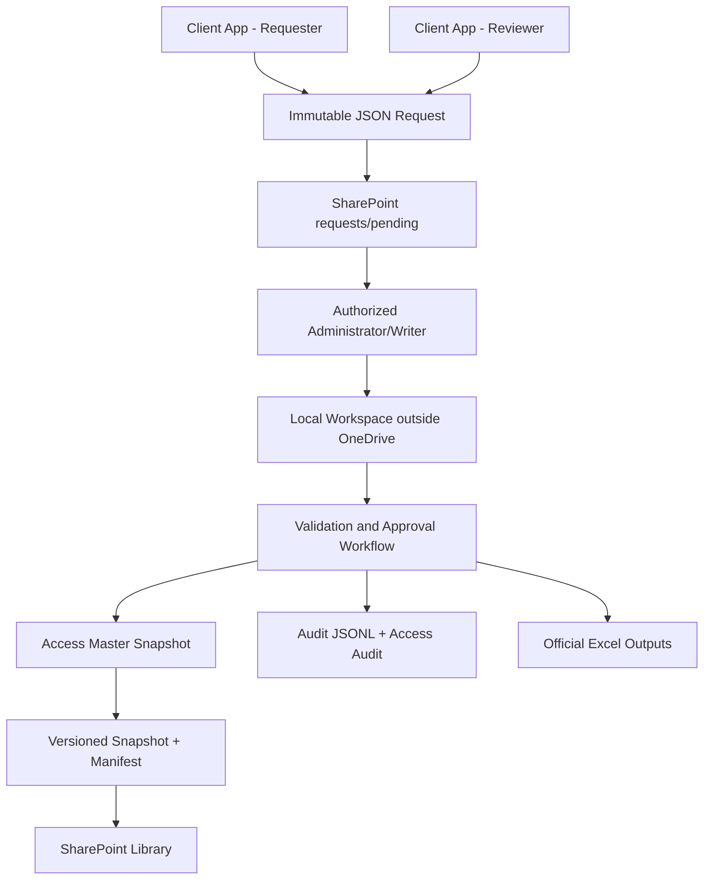

# IAM Automation Architecture Brief

Prepared for: IAM, Marcelo, Operations, and IT Stakeholders  
Date: July 17, 2026  
Status: Corrected proof-of-concept architecture

## Executive Summary

IAM Automation will support employee and user-data automation for SAP Fieldglass, Salesforce, NICE IEX, and future enterprise systems. The corrected architecture reflects the actual infrastructure: there is no server, central API, persistent VM, Windows Service host, or database engine available.

The system must therefore use a single-writer approval workflow. Ordinary user applications create immutable JSON change requests and submit them to a SharePoint request repository. Only an authorized Administrator/Writer imports pending requests, reviews and approves them, applies approved changes to a local Access working copy, validates the result, generates official Excel outputs, and publishes a versioned Access snapshot back to SharePoint.

Microsoft Access is treated as a consolidated versioned snapshot, not as a live distributed multi-user database edited through OneDrive. OneDrive and SharePoint are used for document synchronization, request exchange, published snapshots, audit exports, and Excel outputs, not for transactional write coordination.

The POC must remain compatible with Python 3.10.

## Business Objective

The application should:

- Centralize employee and user data.
- Generate provisioning templates for enterprise systems.
- Validate users and enforce roles.
- Collect proposed changes through immutable request files.
- Support review, approval, rejection, conflict handling, and audit.
- Publish versioned Access snapshots and official Excel outputs.

## Actual Constraints

- No dedicated server, VM, VDI, API host, Windows Service host, or central coordinator.
- No SQL Server, PostgreSQL, MySQL, managed cloud database, or dedicated database engine.
- Users run separately installed copies of the application on Windows workstations.
- Available tools are Access, SharePoint, OneDrive, Excel, Python, Windows identity, and local workspaces.
- SharePoint and OneDrive must not be treated as a transactional database server.

## Corrected Architecture

## Role Separation

| Role | Can Do | Cannot Do |
| --- | --- | --- |
| REQUESTER | Read permitted data, submit change requests, view own status | Modify master data, approve, publish |
| REVIEWER | Read submitted requests, validate business info, recommend decisions | Publish or apply changes unless also writer |
| ADMINISTRATOR / WRITER | Import, approve/reject, apply, publish, recover, export | Bypass audit or version checks |
| AUDITOR | Review requests, decisions, audit, versions, errors | Submit, approve, apply, modify |

## Request Model

Requests are immutable JSON files stored first in `requests/pending`.

Example filename:

`20260717T153500Z_9fb2e618-03fe-4ac2-8aa8-2ab864ade902.json`

Each request includes a globally unique `request_id`, creator identity, computer name, application version, operation type, entity type, entity ID, expected record version, payload, reason, and status.

Corrections create a new request. Original files are preserved.

## Administrator Batch Workflow

1. Validate Administrator/Writer identity and application version.
2. Read current published snapshot version and checksum.
3. Create a local backup.
4. Copy the Access snapshot to a workspace outside OneDrive.
5. Import pending requests by `request_id`.
6. Quarantine malformed or suspicious requests.
7. Reject duplicates.
8. Review, approve, or reject requests.
9. Detect stale record versions.
10. Apply approved non-conflicting requests.
11. Write audit events.
12. Validate referential integrity.
13. Generate official Excel outputs.
14. Create versioned Access snapshot and manifest.
15. Re-read published version before publication.
16. Publish only if the published version did not change.
17. Archive processed requests and write a batch summary.

## Risk Position

The design explicitly avoids direct multi-user Access writes. The highest residual risk is simultaneous Administrator/Writer processing because there is no central lock authority. The mitigation is a combination of restricted writer permissions, operational handoff, advisory writer marker, activity log, idempotent request IDs, and version/checksum comparison immediately before publication.

## Access Database Design

Initial Access schema includes:

- `tbl_Employees`
- `tbl_Users`, `tbl_Roles`, `tbl_UserRoles`
- `tbl_ChangeRequests`
- `tbl_RequestDecisions`
- `tbl_AuditEvents`
- `tbl_Batches`
- `tbl_DatabaseVersions`
- Reference tables for vendors, business units, locations, managers, system profiles, template mappings, export runs, and application versions.

Python must enforce request schema validation, allowed payload fields, idempotency, version checks, and business rules that Access cannot safely enforce alone.

## Publication Versioning

Each published snapshot should use versioned filenames:

`IAM_Master_v000042_20260717T160000Z.accdb`

Each snapshot has a manifest with database version, schema version, publish timestamp, publisher, batch ID, checksum, application version, previous version, and request count applied.

## POC Scope

The current implementation should prove:

- Python 3.10-compatible request creation and validation.
- Role validation.
- Immutable request submission.
- Duplicate request rejection.
- Malformed request quarantine.
- Admin import workflow.
- Access connectivity with `pyodbc`.
- Record-version conflict detection.
- Audit JSONL generation.
- Backup/checksum/snapshot publication controls.
- Example Excel output generation.

## Recommendation

Proceed with the single-writer request-and-approval POC. Do not implement direct client writes to the Access database. Do not introduce a central API, service, Docker, SQL Server, PostgreSQL, Redis, or cloud database into the current architecture. Those belong only in a future migration strategy when infrastructure exists.
