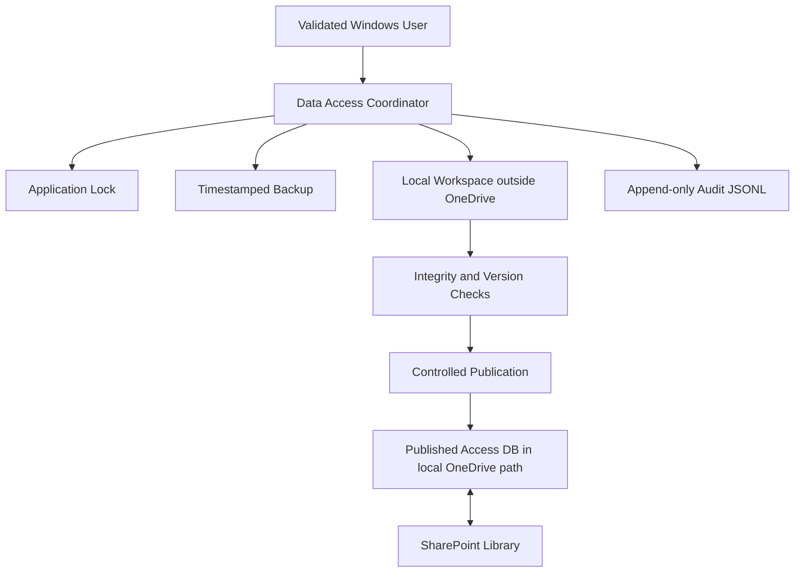

# IAM Automation Architecture Brief

Prepared for: IAM and Operations Stakeholders  
Date: July 17, 2026  
Status: Proof-of-concept architecture, not final production approval

## Executive Summary

IAM Automation is being designed as an internal employee and user-data automation platform. Its purpose is to store common employee data once and generate system-specific onboarding and provisioning templates for SAP Fieldglass, Salesforce, NICE IEX, and future enterprise systems.

The most important architecture constraint is that the current primary database must be a Microsoft Access `.accdb` file stored in a SharePoint document library synchronized locally through OneDrive. That storage model cannot be treated as a normal database server. OneDrive and SharePoint synchronization introduce latency, stale local copies, conflict files, partial uploads, and race conditions that can corrupt or overwrite database changes if multiple users write directly to the synchronized file.

The recommended proof-of-concept architecture is a controlled local-copy workflow: validate the user, validate the SharePoint-synced local path, acquire an application lock, create a backup, copy the published database to a local workspace outside OneDrive, perform the write locally, verify the result, and only then publish back to the SharePoint-synced folder. If the POC confirms frequent multi-user writes, the safest production pattern is likely a single-writer workstation or service.

## Business Objective

The application will centralize employee and user information and use it to generate provisioning templates for enterprise systems. The architecture should support:

- One authoritative employee profile per person.
- System-specific export templates driven by configurable mappings.
- User validation and role-based access.
- Auditability for create, update, export, and recovery operations.
- Controlled database publication to a SharePoint-synced location.
- Future migration to a real database engine when infrastructure becomes available.

## Infrastructure Constraints

- The primary database must currently be Microsoft Access.
- The published Access database must eventually live in SharePoint and sync through OneDrive.
- No SQL Server, PostgreSQL, MySQL, managed cloud database, or dedicated database server is currently available.
- The application must evaluate SQLite but cannot assume SQLite is safe in a synchronized folder.
- Python is the initial POC language, using Access ODBC where available.
- User authentication should initially use the Windows logged-in identity checked against an approved-user registry.

## Critical Risks

| Risk | Impact | Mitigation |
| --- | --- | --- |
| Multiple users write directly to the synced `.accdb` | Lost updates, file locks, corruption | Application lock and single coordinator |
| OneDrive sync starts during a write | Partial upload or conflict copy | Local working copy and controlled publication |
| A stale local copy is published | Newer changes are overwritten | Checksum, version manifest, optimistic concurrency |
| Access driver is missing or incompatible | POC cannot connect or update | Environment validation script |
| Database update fails after partial work | Incomplete data or audit gap | Backup before write and append-only audit |
| User bypasses application workflow | Uncontrolled writes | No direct DB access outside coordinator |

## Architecture Options Under Evaluation

### Option 1: Direct Access Database Usage

Users connect directly to the `.accdb` stored in the local OneDrive-synced SharePoint folder.

Advantages:

- Simple to understand.
- Lowest implementation effort.
- Familiar Access behavior.

Limitations:

- Highest synchronization and corruption risk.
- Access lock files do not protect against OneDrive sync conflicts.
- Difficult to prevent stale local copies from overwriting newer versions.

Assessment: Not recommended unless usage is strictly single-user and POC evidence shows low risk.

### Option 2: Local Working Copy with Controlled Publication

The application copies the published database from OneDrive to a local workspace outside OneDrive, performs operations locally, verifies the result, then publishes back through a controlled process.

Advantages:

- Reduces write exposure inside the synchronized folder.
- Enables backup, checksum, audit, and recovery controls.
- Matches the safest POC path under current infrastructure.

Limitations:

- Still needs application-level locking.
- Still depends on OneDrive sync behavior after publication.
- Requires stale-copy and version checks.

Assessment: Recommended for the POC.

### Option 3: Single-Writer Workstation or Service

All write operations are routed through one designated workstation or service. Other users operate in read-only mode or submit write requests.

Advantages:

- Strongest practical control while Access remains the primary database.
- Serializes writes and reduces conflict probability.
- Easier backup and audit discipline.

Limitations:

- Adds operational dependency on one machine or service account.
- Requires a queue or request workflow.
- Less flexible than a true database server.

Assessment: Recommended if more than one person needs regular write access.

## Recommended POC Architecture

The proof of concept should validate a controlled publication architecture.

1. User opens the application.
2. Application reads the Windows username.
3. Username is validated against an approved-user table or CSV.
4. Path settings are validated.
5. SharePoint URLs are rejected as runtime database paths.
6. Local OneDrive-synced SharePoint paths are required for the published database.
7. Local workspace must be outside OneDrive.
8. Data access coordinator acquires an application lock.
9. Coordinator creates a timestamped backup.
10. Coordinator creates a local working copy.
11. Write operation runs against the local copy.
12. Database state is verified.
13. Updated database is published back.
14. Audit event is written.
15. Lock is released.

## Safe Access Flow

## Core Components

### SharePoint Repository

Stores the published Access database, generated Excel templates, backups, audit exports, configuration files, and publication manifests.

### Local Workspace

Stores temporary working database copies outside OneDrive, for example:

`%LOCALAPPDATA%\IAMAutomation\workspace`

### Data Access Coordinator

The coordinator is the only component allowed to perform database operations. It validates paths, locks the operation, computes checksums, creates backups, writes locally, verifies results, publishes updates, and records audit events.

### Application Lock

The lock should include lock ID, user, computer, process ID, operation, start timestamp, expiration timestamp, database checksum, database version, and application version. The initial implementation uses a JSON lock file in the SharePoint-synced root and includes stale-lock behavior.

### Optimistic Concurrency

Employee records should include `record_version`, `created_at`, `created_by`, `modified_at`, and `modified_by`. Updates should include `WHERE record_version = expected_version`; if zero rows are updated, the application must reject the stale update.

### User Validation

The first version uses the logged-in Windows user and checks authorization against an approved-user registry. Initial roles are Administrator, IAM Analyst, Reviewer, Read-only User, and Auditor. Plaintext passwords are not stored.

### Audit Trail

Every operation writes an immutable audit event with timestamp, user, computer, action, entity, previous values, new values, database version, result, error details, and correlation ID. Audit must work even if the database write fails.

## Access vs. SQLite Position

SQLite should be evaluated, but it does not automatically solve the SharePoint/OneDrive synchronization problem. Both Access and SQLite are file-based databases. If either database file is edited by multiple computers through sync folders, stale copies and conflict files remain possible.

The key decision is not simply Access versus SQLite. The key decision is whether the application can safely coordinate writes to a file-based database stored in a synchronized document library.

## Decision Gates

The full IAM application should not be implemented until the POC answers:

1. Can Python reliably connect to Access in the target Windows environment?
2. Which Access driver and Python version are supported?
3. What happens during concurrent reads and writes?
4. Can the application reliably prevent simultaneous publication?
5. Can stale local copies be detected?
6. Can backup and recovery be executed consistently?
7. Does SQLite provide meaningful advantage under the same sync restriction?
8. Is a single-writer architecture required?
9. How will user validation be enforced?
10. What future migration path should be recommended?

## Current POC Deliverables

- Python package for path validation, user validation, locking, checksums, audit, Access driver discovery, and controlled write coordination.
- Sample configuration using local OneDrive-synced SharePoint paths.
- Environment validation script.
- Access connectivity experiment script.
- Application locking experiment script.
- SQLite optimistic concurrency experiment script.
- Documentation set covering risks, concurrency, validation, audit, backup, and recovery.
- Mermaid diagram sources for architecture and workflow presentation.

## Recommendation

Proceed with the controlled local-copy POC. Do not allow direct multi-user writes to the synchronized Access database. If the POC shows more than occasional write activity or any ambiguity in OneDrive conflict behavior, move to a single-writer pattern until a real database server is available.

The future-state architecture should use SharePoint for documents, templates, and audit exports, while moving transactional employee and IAM data to SQL Server, PostgreSQL, or a managed database platform when infrastructure permits.
