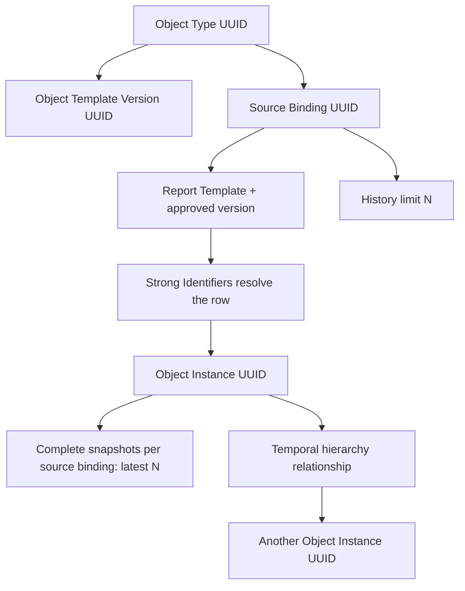

# Import Engine Design Handoff

**Prepared:** October 1, 2026
**Purpose:** Resume the import-engine architecture and implementation work tomorrow.
**Implementation status:** Design and repository review only; no code was changed for this handoff.

## Decisions and requirements confirmed today

1. **An Object Type is a reusable definition, not a row or an imported entity.**
   Its UUID stays stable across configuration edits. Each approved configuration
   has its own Object Template Version UUID.
2. **An Object Type can have multiple source bindings.** Each binding represents
   one pinned Report Template version and its per-source configuration,
   including a user-selected history limit `N`.
3. **Imports create or resolve Object Instance UUIDs.** Strong Identifiers
   resolve an incoming report row to an instance. They are business keys, not
   the instance's primary key.
4. **History is retained per object instance and source binding.** A snapshot is
   the complete set of included properties from one accepted row/report
   version. If `N = 2`, retain the latest two complete snapshots for that
   object from that binding. The count is not a file-discovery cap and does not
   mean keeping only two changed columns. Discovery and auditing can still see
   more than `N` files; `N` controls the retained object-property snapshots.
5. **Strong Identifiers resolve identity; the report binding scopes history.**
   This preserves the full report-template property set together as one
   source-specific snapshot. A changed Strong Identifier value needs an
   explicit re-key/alias policy; it must not silently create a second object.
6. **Hierarchy is a separate, temporal relationship between instances.**
   It is not inferred from report order or from a Strong Identifier match.
   Relationship type, direction, cardinality, and validity interval need to be
   explicit before imports can write hierarchy links.
7. **More than one Object Type must be configurable.** Different Object Types
   may select different report templates. A report template may be shared only
   when source routing to the intended Object Type is deterministic and
   approved.
8. **Keep the new engine isolated from legacy Employee tables and workflows.**
   Import writes must remain in engine-owned structures until a separately
   reviewed integration contract exists.
9. **The engine should process file batches and use set-based identity lookup,**
   rather than making a database round trip for every row and scanning prior
   JSON evidence. Preserve row-level diagnostics and quarantine while reducing
   repeated parsing and matching work.

## Proposed identity and history flow

The version UUID freezes configuration. The stable Object Type UUID groups
those versions. The Source Binding UUID owns a pinned report-version
association and its history policy. Each imported row is resolved through its
configured Strong Identifier mapping to an Object Instance UUID; the accepted
row then contributes one complete snapshot under that instance and binding.

## Fixture review: `rosterlocks`

Reviewed folder: [`tests/fixtures/sharepoint_simulated/rosterlocks`](../../tests/fixtures/sharepoint_simulated/rosterlocks)

The current fixture set contains **5 Excel files and 111 rows**, not 13 files.
The files contain 79, 1, 1, 15, and 15 rows. There are 110 distinct non-empty
Vendor employee IDs: one identity appears twice across two files. One occurrence
is in the larger June/July submission workbook; the other is in a 15-row
change-role workbook. This is a useful small example of repeated snapshots, not
a representative scale benchmark.

The repeated person's stable identity attributes (name, email, country and
vendor ID) match. The later row changes or adds fields including supervisor,
site suffix, project, title, onboarding/production date, license/NPN values,
roster status (`New Hire` to `Change role`) and an approval status. Some fields
that were populated before are blank in the later row. The importer must decide
whether blank means **clear the prior value** or **field not supplied / leave
unchanged** for each supported source format. Never guess at that distinction.

This analysis is recorded without copying personal values into this document.
It establishes that the sample contains at least one repeated identity and a
multi-property update. It does not establish the expected retention limit or
the correct business precedence for each field.

## Current implementation baseline and gaps

- `iam_automation/application/ingestion/object_template_repository.py` stores
  every Object Template under the fixed key `EMPLOYEE_PROFILE`; it cannot
  persist multiple independently named Object Types.
- `iam_automation/application/parallel_engine/templates.py` loads one latest
  approved object snapshot and builds one runtime configuration.
- `iam_automation/application/parallel_engine/contracts.py` models one
  `ObjectTemplate` with a tuple of report sources. It has no stable Object Type
  ID, Source Binding ID, or retention policy.
- `iam_automation/application/parallel_engine/database.py` is engine schema
  version 4. `engine_v2_objects.object_id` is already a UUID, but objects point
  to a template *version*. Evidence stores complete source rows as JSON, and
  `engine_v2_object_evidence` links evidence to objects. There are no physical
  Strong Identifier values, property snapshots, source-binding history limits,
  or temporal hierarchy tables.
- `iam_automation/application/parallel_engine/engine.py` persists rows and
  `_find_object()` resolves configured links by loading staged evidence JSON and
  examining values in Python. This work grows with historical evidence and
  should become indexed identifier lookup plus batched resolution.
- `iam_automation/application/parallel_engine/reader.py` parses CSV/XLSX to
  `ParsedSourceRow` objects. It is the natural boundary for read-once parsing,
  normalization and bounded row chunks.
- `iam_automation/application/parallel_engine/watcher.py` discovers files and
  persists recognition analyses. It should continue separating discovery from
  import; history `N` must not be implemented as a watcher file-count limit.
- `iam_automation/interfaces/web/ingestion_configuration_routes.py`,
  `iam_automation/templates/admin/ingestion_object_template_settings.html`,
  and `iam_automation/templates/admin/_object_template_card.html` currently
  implement one Object Template draft/approval flow in Template Library.
  Supporting multiple objects requires a collection/list, create/edit routes,
  and per-object approval actions.
- `iam_automation/templates/parallel_engine/dashboard.html` and
  `dashboard_integrated.html` present operations for the current single active
  Object Template. They will need to report activity/counts per source binding
  and object type when multiple types run.
- `tests/test_parallel_engine.py` is the focused current runtime regression
  suite. Add targeted tests when implementation is requested; this design task
  did not run or add tests.

The readiness review in
[`2026-09-30_IMPORT_READINESS_AND_PLAN.md`](2026-09-30_IMPORT_READINESS_AND_PLAN.md)
remains authoritative: production file processing is gated off until the
physical model, Rules Engine coordination, and acceptance criteria are met.

## Faster import pipeline to implement

### 1. Parse and normalize each file once

- Read stable, recognized files once, using the pinned Report Template version.
- Normalize a chunk of rows in memory; preserve original row/sheet coordinates
  and collect row diagnostics without issuing per-cell or per-row SQL.
- Compute a canonical row fingerprint and normalized Strong Identifier keys
  once. Use a keyed digest for indexed lookup if storing raw identifier values
  is not required for operations; preserve the protected source value/provenance
  where audit policy requires it.
- Skip unchanged rows/files idempotently by source binding, file checksum and
  row identity/fingerprint. A file checksum alone cannot suppress a changed
  workbook whose new rows were appended or whose older rows were revised.

### 2. Resolve identifiers in batches

- Build a distinct set of Strong Identifier lookup keys for each configured
  binding/link group.
- Query a dedicated identifier table through composite indexes in batches,
  rather than selecting every historical evidence JSON record and comparing in
  Python.
- Partition keys into `no match`, `one match`, and `multiple matches`. Create
  instances only for approved bindings with sufficient creation authorization;
  quarantine ambiguous keys and retain actionable diagnostics.
- Enforce uniqueness at the documented scope (Object Type + identifier type
  and any needed source/validity dimensions). Strong-key collisions must not
  merge objects automatically.

### 3. Write atomically in bounded chunks

- Persist one import batch and its row outcomes with bulk inserts / executemany
  inside bounded transactions. Chunk size should be configurable and tuned from
  measurements; avoid one unbounded transaction for a huge workbook.
- Keep file-level idempotency and add row-level idempotency so retries after a
  partial chunk do not duplicate evidence, identifiers, or snapshots.
- Persist raw evidence, normalized/protected evidence, identifier ownership,
  object resolution, and full snapshots with explicit foreign keys and source
  lineage. Commit a chunk consistently or roll it back and retry/quarantine it.
- Bound concurrency around SQLite writes (single writer or a small queue); do
  not parallelize writes in a way that causes lock contention or broken
  transactions. Parallel parsing may be considered after profiling.

### 4. Apply snapshot retention after accepted writes

- Use a monotonically sortable source event key: business effective timestamp
  where trustworthy, then file modified/submission timestamp, then batch and
  row as deterministic tie-breakers. Arrival time alone may process late files
  out of chronological order.
- Store complete source-binding snapshots and calculate the latest `N` per
  `(object_instance_uuid, source_binding_uuid)`. Apply retention transactionally
  after idempotent persistence; keep `N = 0` semantics explicit (unlimited or no
  snapshots must be a deliberate product decision, not an implicit default).
- Separate operational snapshot retention from audit/evidence retention.
  Trimming a snapshot must not accidentally delete authorization, diagnostics,
  file checksums, import lineage, or a legally required audit record.
- Retention changes need a clear policy: lowering `N` can prune already stored
  snapshots; raising `N` cannot recreate history already deleted.

### 5. Measure actual bottlenecks

Record per-file and per-stage durations and counts: rows parsed, duplicate
fingerprints skipped, identifiers looked up, matches/ambiguities, objects
created, snapshots retained/pruned, quarantines, rows/sec, and DB time. Use the
fixture first for correctness, then a generated large workbook for throughput.
Do not claim scale based only on the 111-row fixture.

## Failure modes to design for before enabling writes

| Failure mode | Required behavior |
|---|---|
| Two Object Types accept the same file | Require deterministic routing or reject as ambiguous before row import. |
| Duplicate Strong Identifier maps to different instances | Quarantine as ambiguous; do not merge or choose the first. |
| Strong Identifier changes in a later row | Require an explicit alias/re-key path with provenance and collision checks. |
| Same file retried after partial chunk commit | Resume idempotently by stable batch/chunk/row keys. |
| Late-arriving file has an older effective date | Recompute ordering/retention using event time, not processing order. |
| Empty value might mean clear or omitted | Define per format/field semantics and preserve the raw distinction if possible. |
| Source template or Object Template changes mid-run | Pin version IDs for the full batch; never mix definitions within it. |
| History limit changes | Apply a visible prune/retention policy and report irrecoverable prior trimming. |
| Shared source contributes to multiple types | Keep per-binding routing, identity namespace, and snapshot history independent. |
| Hierarchy edge points to a missing/deleted instance | Enforce foreign keys and relationship lifecycle/cardinality rules. |
| SQLite gets concurrent writers or oversized transaction | Bounded chunks, busy handling/retry, and an explicit writer strategy. |
| Retention deletes evidence needed for audit/replay | Separate snapshot pruning from durable batch/evidence/audit lifecycle. |

## File map for the implementation session

### Configuration and approvals

- `iam_automation/application/ingestion/object_template_repository.py` —
  replace the single fixed-key assumption with stable Object Type identity and
  immutable Object Template versions; support listing, loading and draft save
  per type.
- `iam_automation/interfaces/web/ingestion_configuration_routes.py` — add
  create/edit/list/approve endpoints scoped by Object Type UUID; validate
  report-source routing, Source Bindings, Strong Identifiers, history limits,
  and temporal hierarchy configuration on the server.
- `iam_automation/templates/admin/ingestion_object_template_settings.html`,
  `iam_automation/templates/admin/_object_template_card.html`, and likely
  `iam_automation/static/js/ingestion-template-library.js` — let admins create
  multiple Object Types, configure each binding's `N`, and see independent
  draft/approved state and validation messages.
- `iam_automation/application/parallel_engine/templates.py` and
  `contracts.py` — load all approved object types and resolve pinned report
  versions/routing into immutable runtime configuration contracts.

### Runtime schema and import pipeline

- `iam_automation/application/parallel_engine/database.py` — add versioned,
  additive engine migrations. Candidate structures: stable object types and
  version snapshots; source bindings; object instances keyed by UUID; normalized
  Strong Identifier values with uniqueness/indexes; source facts/evidence;
  complete snapshots keyed by instance + binding + event order; temporal object
  relationships. Final schema and identifier privacy strategy need a design
  review first.
- `iam_automation/application/parallel_engine/reader.py` — normalize in
  bounded chunks and emit fingerprints and typed diagnostics while keeping
  source row lineage.
- `iam_automation/application/parallel_engine/engine.py` — orchestrate
  file-level idempotency, bulk staging, batched indexed resolution, object
  creation, snapshot writes/retention, and per-stage metrics. Keep policy
  decisions out of ad hoc loops where a repository/service can enforce them.
- `iam_automation/application/parallel_engine/watcher.py` — remain discovery
  and stable-file coordination; route each recognized file to the correct
  approved Object Type/Source Binding and report per-binding activity. Do not
  confuse observed-file count with snapshot retention.
- `iam_automation/application/parallel_engine/contracts.py` — model
  ObjectType, ObjectTemplateVersion, SourceBinding, history policy, resolved
  row identity, snapshot event order and temporal relationship contracts.
- `iam_automation/templates/parallel_engine/dashboard.html`,
  `dashboard_integrated.html`, and `iam_automation/static/parallel_engine/engine.css`
  — expose per-type/per-binding scan and import state, counts, history pruning,
  and errors once runtime execution is enabled.

### Documentation and evidence

- `docs/ingestion-engine/OBJECT_IDENTITY_AND_TEMPLATE_LIFECYCLE.md` — reconcile
  its existing identity/lifecycle contract with the UUID/source-binding/history
  model and temporal hierarchy policy.
- `docs/ingestion-engine/2026-09-30_IMPORT_READINESS_AND_PLAN.md` — update
  production gates and migration phases after the schema is chosen.
- `tests/test_parallel_engine.py` — when implementation begins, cover repeated
  identity updates, `N` snapshot retention, collisions, multiple object types,
  routing ambiguity, late arrivals, retry/idempotency, and temporal hierarchy.
- Add a focused migration/schema test module if needed. Avoid encoding tests
  against a provisional schema before its invariants are agreed.

## Recommended order for tomorrow

1. Agree on history meaning, blank/update semantics, event ordering,
   identifier uniqueness scope, and audit retention.
2. Design the minimal schema and write its invariants/migration plan before
   enabling any new physical writes.
3. Build one vertical slice: one Object Type, one Source Binding, two repeated
   rows for one Strong Identifier, complete snapshots with `N = 2`, and a
   deterministic rerun that creates no duplicate objects or snapshots.
4. Add a second Object Type with a different source to prove independent
   configuration and ensure the first type remains unchanged.
5. Add cross-type temporal relationships only after the two-type identity and
   property snapshot slice is sound.
6. Profile with a larger generated input and use measurements to choose chunk
   size/index strategy before considering concurrent parsing.
7. Keep production processing gated until the Rules Engine gate, review flow,
   deletion lifecycle, privacy, audit, and rollback behavior are specified and
   verified.

## Existing documents to keep in sync

- [Object identity and template lifecycle](OBJECT_IDENTITY_AND_TEMPLATE_LIFECYCLE.md)
- [Import readiness review and implementation plan](2026-09-30_IMPORT_READINESS_AND_PLAN.md)
- [Template creation, library, and Object Template review](2026-10-01_template_creation_library_object_review.md)
- [Four-source match findings](2026-09-24-four-source-match-findings.md)
- [Ingestion Engine work area](README.md)
